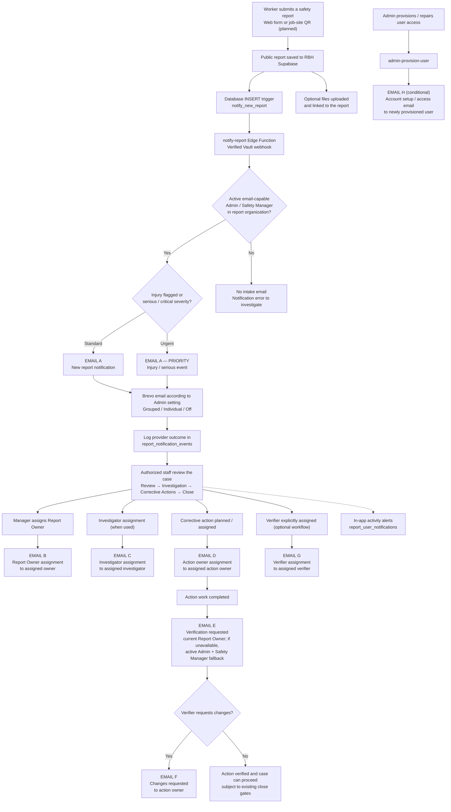

# TeamWorkt Safety — Email and Notification Flow (RBH Pilot)
**Verified against live deployed Supabase Edge Functions on November 14, 2026.**

> This is the editable, source-verified counterpart to the original email infographic generated in the conversation. GitHub renders the Mermaid diagram below as a graphic. The original PNG is retained as a conversation attachment. Do not treat the conceptual original as a complete implementation specification where this code-derived diagram is more specific.

## Live routing: initial safety report

**Initial new-report email = active users whose role is `admin` or `safety_manager` within the report's company, provided they have an email address.** There is no initial new-report email to the `supervisor` or `read_only` role. The recipient list is resolved on each report submission from `public.profiles`, not from a hard-coded address list.

**Currently configured RBH test accounts:** 1 active Admin with an email, 0 Safety Managers, 2 active Read Only users and 1 inactive Read Only user. Therefore **1 current eligible initial email recipient**, as of the database check. The count will change when eligible accounts are added.

By default, the new-report email is a **grouped Brevo message** to eligible recipients (the Admin can now change it to individual or off), with per-recipient `report_notification_events` tracking/deduplication. When `involves_injury=true`, the existing recipient group is preserved but the subject receives **HIGH PRIORITY – INJURY** treatment. Serious/critical severity also triggers warning styling when not injury-flagged. A missing eligible recipient group returns a notification error; the report record already exists.

## Email triggers and recipients — current function capabilities

| Label | When | Intended recipient | Current implementation notes |
|---|---|---|---|
| **A — New report** | New `reports` row inserted | Every **active Admin + Safety Manager** in same organization with valid email | `notify-report` version observed: 39; Brevo grouped To recipients, per-recipient event record. Injury uses high-priority subject/banner. **Not Supervisor / Read Only** on initial intake. |
| **B — Report owner assignment** | Manager assigns Report Owner, with email action invoked | Assigned Report Owner | `send-action-assignment-email` supports `report_owner_assignment`. |
| **C — Investigator assignment** | Investigator assigned, where the preserved workflow invokes it | Assigned investigator | Function supports `investigator_assignment`; verify actual UI event invocation during browser tests. |
| **D — Corrective action assigned** | Action assigned | Assigned corrective action owner | Function supports `assignment`. |
| **E — Verification requested** | Completed action requires verification and notification invoked | Current Report Owner; if no active owner, active Admin/Safety Manager fallback | Function supports `verification_requested`. |
| **F — Changes requested** | Verifier/owner requests additional work, notification invoked | Assigned corrective action owner | Function supports `changes_requested`. |
| **G — Verifier assignment** | Verifier assigned where optional workflow invokes it | Assigned verifier | Function supports `verifier_assignment`. |
| **H — User setup/access** | Admin provisions access and setup email configuration/link generation succeeds | Newly provisioned user | `admin-provision-user` may create access while returning an email warning if setup email cannot send. |

**Important distinction:** This chart shows the recipient routing implemented by the deployed functions. For B–G, the function's support for an event does **not alone** confirm that every dashboard action currently calls that event; end-to-end UI trigger verification is a required MVP test. The existing in-app notification center is a separate workflow and is not an email. Closure, restart, reopening and other events should not be described as automatic emails unless verified in the calling code.

## Build 2 — Admin-controlled initial email delivery (2026-11-15)

**Implemented in RBH pilot:** Admin → New report email notifications. An authorized active company `admin` can choose:
- **Grouped (default):** one Brevo message addressing active Admin and Safety Manager recipients together, preserving the existing behavior.
- **Individual:** separate Brevo message for each eligible recipient; each retains its own notification audit event and provider message ID.
- **Off:** suppresses **all initial new-report emails**, including high-priority injury intake emails. The Admin UI explicitly warns and requires confirmation. Reports still save and are visible in the dashboard.

The setting affects **only email A — new report**. Existing assignment/workflow email events B–H, role eligibility, in-app notifications and report submission are unchanged. Settings are keyed by the company's organization, guarded by Admin-only SQL RPCs; missing setting defaults to grouped. SQL applies from `supabase/patches/20261115_teamworkt_report_email_preferences.sql` and the deployed `notify-report` Edge Function is version 40.

**Verification status:** Database RPC defaults, individual/off settings, invalid values and read-only user denial passed transactional tests (rolled back, so the live setting remains grouped). Browser settings UI and actual Brevo grouped/individual delivery need owner-driven end-to-end tests. No new test email was deliberately sent as part of this update.

## November 15, 2026 — Live RBH email setting tests

**Two eligible active profiles confirmed:** Admin `mikevignery@hotmail.com` and Safety Manager `vignery12@gmail.com`, same RBH organization.

- **Grouped, test report #44** (`9c021b61-4e40-477d-8b15-8e3f43f4a1bb`): two notification audit events marked `sent`; **same Brevo provider message ID** for both intended recipients. Provider acceptance confirmed; inbox arrival not independently confirmed.
- **Individual, test report #45** (`62b8a5fb-12cc-482c-81cb-76691a36b30d`): two events marked `sent`; **different Brevo provider message IDs**, one per recipient. Provider acceptance confirmed; inbox arrival not independently confirmed.
- **Off, test report #46** (`237e085b-099c-4fb7-8ec9-5b9e89115252`): report saved; zero email events. Edge Function logs explicitly show `New-report email disabled by company Admin setting` and successful HTTP 200 response.
- **Restored default:** RBH `report_email_settings.delivery_mode='grouped'`, verified after tests.
- All three new reports are labeled **TEST ONLY** and describe fictional, non-injury concerns. They were retained for test/audit traceability. No data was purged.
- **Still unverified:** independent confirmation that emails reached recipients' inboxes, and a browser interaction test using the Admin dropdown. Backend routing and provider acceptance tests passed.

## Verification checklist for next build
- [ ] New anonymous report sends a single grouped intake email to current active Admin/Safety Manager recipients; no Supervisor or Read Only inclusion.
- [ ] Injury flag preserves recipients but changes visible priority treatment.
- [ ] Assign Report Owner, investigator, action owner and verifier; confirm the dashboard calls the expected email action and the intended assignee receives it.
- [ ] Complete, request verification, request changes and reassign; verify correct recipient, log, duplicates and failed events.
- [ ] User provisioning email arrives or clearly reports a delivery warning; password recovery remains secure.
- [ ] Compare Brevo provider acceptance, actual inbox delivery when available, and `report_notification_events` / in-app notifications.
- [ ] Use test accounts and fictional reports only.

## Sources and scope
- Direct inspection: deployed RBH Edge Functions `notify-report` (version 39), `send-action-assignment-email` (version 13), `admin-provision-user` (version 5), and current RBH `public.profiles` role counts.
- No live SQL migrations, emails, or credentials are introduced by this documentation.
